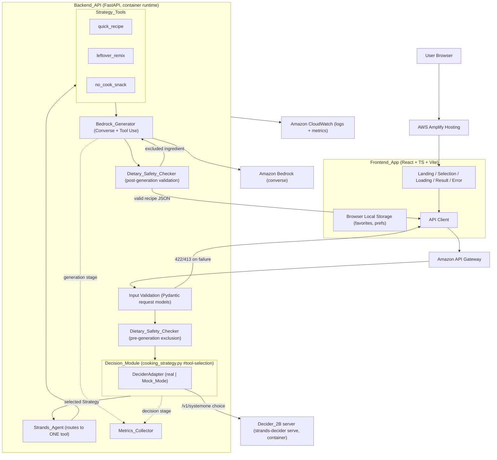
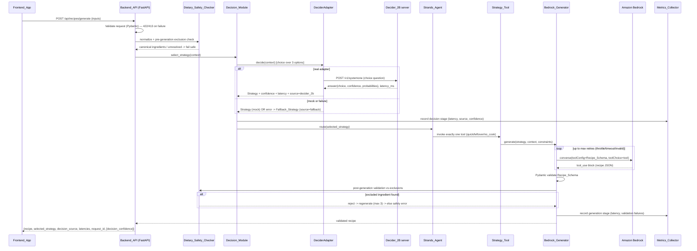
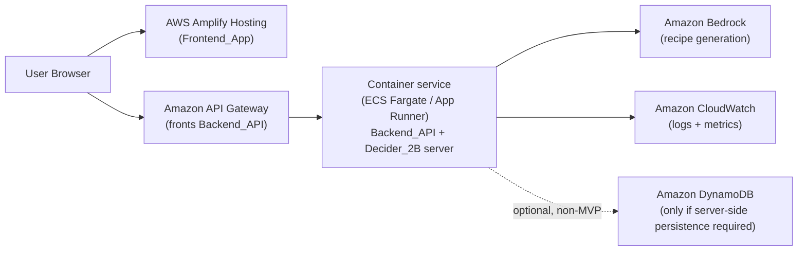

# Design Document

## Overview

CraveQuest is an AI-powered food-adventure web app whose defining feature is a genuine, observable
cooking-strategy decision made by **Strands Decider 2B** (hackathon pattern tag `#tool-selection`),
followed by generative recipe creation on **Amazon Bedrock**. This document describes the backend
decision/generation pipeline, the three strategy tools, the API surface, the React frontend, the
deterministic dietary safety layer, the reusable decision-pattern deliverable, security/cost controls,
and the AWS deployment with its runtime-compatibility analysis.

The design is scoped to a hackathon MVP that one developer can build. It keeps the decision layer small,
typed, and independently testable, isolates all external integrations behind interfaces, and is explicit
about where a result is a genuine `Decider_2B` decision versus a labeled `Mock_Mode` or deterministic
`Fallback_Strategy` result.

### Research sources informing this design

External integration details below are grounded in the following documented sources. Content was
rephrased for compliance with licensing restrictions.

- **Strands Decider** repository — `github.com/strands-labs/strands-decider` (server/CLI, question
  types `noul`/`choice`/`score`, `/v1/systemone` and `/v1/decisions` formats, `confidence`/`latency_ms`
  in responses, local `127.0.0.1` bind with no auth, device selection CUDA→MPS→CPU).
- **LiteLLM Strands Decider provider** — `docs.litellm.ai/docs/providers/strands_decider`
  (`litellm.systemone(...)` / `litellm.decisions(...)` SDK calls, `STRANDS_DECIDER_API_BASE` and optional
  `STRANDS_DECIDER_API_KEY` env vars, async variants).
- **Amazon Bedrock Converse API with Tool Use** — AWS Bedrock documentation (boto3 `bedrock-runtime`
  `converse`, `toolConfig` + `toolChoice` to force a single structured `tool_use` response, model access
  must be enabled per region).

### Key design decisions and rationale

1. **Decider behind an adapter with two implementations.** A `DeciderAdapter` interface with a real
   LiteLLM/HTTP implementation and an explicitly labeled `Mock_Mode` implementation, selected by
   `DECIDER_MODE=real|mock`. This satisfies Req 34 (adapter + labeled mock) and Req 2.8 (normal choice
   comes from inference, not a conditional tree) while letting the UI be built without the 2B model.
2. **The decision drives tool routing, not an LLM.** `Decider_2B` returns a `choice` over exactly three
   options; that choice deterministically selects exactly one `Strategy_Tool`. The Bedrock LLM generates
   recipe *content* but never *chooses* the tool (Req 5, Req 2.8).
3. **Structured Bedrock output via Tool Use.** Bedrock is forced to return a single `tool_use` block whose
   input matches the `Recipe_Schema` JSON Schema, then validated with Pydantic v2. This gives reliable
   structured JSON instead of free-text parsing (Req 9, Req 10).
4. **Deterministic safety, not prompt-only.** The `Dietary_Safety_Checker` normalizes ingredient names and
   enforces exclusions before and after generation, independent of prompt text (Req 23, 24, 25).
5. **Container runtime for the Decider server.** The 2B model weights and long-running serving process
   exceed Lambda's package/memory/duration limits, so the design recommends a container runtime (Req 28.3/28.4).

## Architecture

### High-level architecture



Request flow: Browser → Amplify-hosted frontend → API Gateway → FastAPI `Backend_API` → input validation →
pre-generation `Dietary_Safety_Checker` → `Decision_Module`/`DeciderAdapter` (calls the `Decider_2B` server,
or `Mock_Mode`, or deterministic `Fallback_Strategy` on failure) → `Strands_Agent` routes to exactly one
`Strategy_Tool` → `Bedrock_Generator` (Bedrock `converse` with Tool Use) → post-generation dietary
validation → JSON response. `Metrics_Collector` instruments decision and generation stages separately, and
all components emit logs/metrics to CloudWatch.

### Sequence diagram — POST /api/recipes/generate



### Module layout (Req 33)

```
backend/
  app/
    main.py                         # FastAPI app, CORS, body-size limit, routers
    config.py                       # env-driven settings + startup validation (thresholds, timeouts)
    api/
      health.py                     # GET /health
      recipes.py                    # POST /api/recipes/generate, /regenerate
      metrics.py                    # GET /api/metrics/summary (protected/excludable)
    agent/
      orchestrator.py               # Strands_Agent wiring: decision -> single tool
    tools/
      quick_recipe.py               # @tool quick_recipe
      leftover_remix.py             # @tool leftover_remix
      no_cook_snack.py              # @tool no_cook_snack
    decision_patterns/
      cooking_strategy.py           # Decision_Module (#tool-selection) — reusable
      README.md                     # pattern documentation
    models/
      recipe.py                     # Recipe_Schema, Ingredient, difficulty enum
      requests.py                   # GenerateRequest / RegenerateRequest
      responses.py                  # GenerateResponse, decision metadata, error models
    services/
      decider_adapter.py            # DeciderAdapter interface + Real + Mock implementations
      bedrock_generator.py          # Bedrock_Generator (converse + Tool Use)
      metrics_collector.py          # Metrics_Collector
    safety/
      dietary_safety_checker.py     # normalization, alias map, pre/post checks
  tests/
    ...
scripts/
  benchmark_decisions.py            # Benchmark_Script
frontend/
  ... (React + TS + Vite)
infra/
  ... (AWS CDK or SAM)
```

## Components and Interfaces

### Decision_Module and DeciderAdapter (Req 2, 3, 4, 34)

The `Decision_Module` (`cooking_strategy.py`) owns strategy selection. It isolates `Decider_2B` behind the
`DeciderAdapter` interface and applies the configurable confidence threshold, the deterministic fallback, and
the metrics hooks.

```python
# services/decider_adapter.py
from dataclasses import dataclass
from enum import Enum
from typing import Protocol, Optional

class Strategy(str, Enum):
    QUICK_RECIPE = "QUICK_RECIPE"
    LEFTOVER_REMIX = "LEFTOVER_REMIX"
    NO_COOK_SNACK = "NO_COOK_SNACK"

class DecisionSource(str, Enum):
    DECIDER_2B = "decider_2b"
    FALLBACK = "fallback"

@dataclass
class DecisionResult:
    strategy: Strategy
    source: DecisionSource
    decision_latency_ms: int            # non-negative integer (Req 2.6)
    confidence: Optional[float] = None  # 0.0..1.0 when genuinely available (Req 2.5, 12.2/12.3)
    is_mock: bool = False               # Mock_Mode indicator (Req 34.3)
    below_threshold: bool = False       # confidence < configured threshold (Req 3.4)

class DeciderAdapter(Protocol):
    """Documented interface isolating Decider_2B (Req 34.1)."""
    def decide(self, state: str, options: dict[str, str], timeout_ms: int) -> DecisionResult:
        """Return a choice over exactly the given options, with confidence+latency when available.
        Raises DeciderError on timeout, transport error, or out-of-set answer."""
```

**RealDeciderAdapter** calls the `Decider_2B` server using the `choice` question type over exactly the three
options `QUICK_RECIPE`, `LEFTOVER_REMIX`, `NO_COOK_SNACK` via the `/v1/systemone` format. Per the LiteLLM
Strands Decider provider, the call uses `litellm.systemone(model="strands_decider/<checkpoint>", state=...,
questions={...})` with `STRANDS_DECIDER_API_BASE` pointing at the server (e.g. `http://127.0.0.1:8000`) and
optional `STRANDS_DECIDER_API_KEY` bearer token. The model checkpoint is read from configuration (never
hardcoded, Req 34.4). Request shape (System One format):

```jsonc
{
  "state": "<meal-decision context text>",
  "questions": {
    "cooking_strategy": {
      "type": "choice",
      "instructions": "Pick the single best cooking strategy for this situation.",
      "criteria": {
        "QUICK_RECIPE":   "User can cook and has enough time/energy for a short cooked meal.",
        "LEFTOVER_REMIX": "User wants to combine existing ingredients with minimal extra purchases.",
        "NO_COOK_SNACK":  "User cannot or will not cook; needs a no-heat option."
      }
    }
  }
}
```

The response carries `answers.cooking_strategy.choice`, `.confidence`, `.probabilities`, plus top-level
`latency_ms` (source: Strands Decider repo; rephrased). The adapter maps `choice` to the `Strategy` enum,
reads `confidence` (genuinely available, so Req 2.5 and the Req 3 threshold apply), and records
`latency_ms` (also measured client-side as a cross-check, Req 2.6).

**MockDeciderAdapter** (`Mock_Mode`, Req 34.2/34.3) returns a deterministic labeled result with
`is_mock=True` and no genuine `confidence` (so the API omits `decision_confidence`, Req 12.3). It is enabled
only by explicit `DECIDER_MODE=mock`. Its output is never presented as genuine inference (Req 18.2, 34.3).

**Fallback (Req 4).** The `Decision_Module`, not the adapter, applies the deterministic `Fallback_Strategy`
when the adapter raises (timeout `DECISION_TIMEOUT_MS` default 5000, transport error) or returns an
out-of-set value (Req 2.4). The fallback is a simple, explicitly-documented deterministic rule — **not** the
normal decision path:

```
if cooking_preference == "no_cook":                         -> NO_COOK_SNACK
elif energy_level == "low" and available_time_minutes < LOW_ENERGY_TIME_THRESHOLD:  -> NO_COOK_SNACK
elif budget == "low" and len(ingredients) >= MANY_INGREDIENTS_THRESHOLD:            -> LEFTOVER_REMIX
else:                                                       -> QUICK_RECIPE
```

On fallback, `source=fallback`, the `Metrics_Collector` records a decision failure and does **not** count a
successful inference (Req 4.3), and the response carries `decision_source="fallback"` (Req 4.4).

The confidence threshold (`DECISION_CONFIDENCE_THRESHOLD`, default 0.5) is read from config (Req 3.2),
validated at startup to be within 0.0–1.0 or startup fails (Req 3.3), and when a genuine confidence is below
it the module records `below_threshold=True` in decision metadata (Req 3.4). Per Req 3, a below-threshold
confidence is recorded but does not itself force fallback (fallback is reserved for inference failure).

### Strands_Agent orchestration (Req 5)

```python
# agent/orchestrator.py
def run_request(context: MealContext) -> GenerateResponse:
    decision = decision_module.select_strategy(context)   # DecisionResult
    tool = TOOL_BY_STRATEGY[decision.strategy]             # exactly one tool
    recipe = tool(context, decision.strategy)             # invokes Bedrock_Generator inside
    return assemble_response(recipe, decision)
```

`TOOL_BY_STRATEGY` maps each `Strategy` to exactly one `@tool` function so the agent executes exactly one
tool per request (Req 5.1–5.5). The Decider's choice — not the LLM — determines the tool (Req 2.8).

### Strategy tools (Req 6, 7, 8)

All three are Strands `@tool` functions with the same signature; each imposes its strategy-specific
constraints, then delegates content generation to the `Bedrock_Generator`.

```python
# tools/*.py
from strands import tool

@tool
def quick_recipe(context: MealContext) -> Recipe: ...      # combined time <= available_time; +<=5 extra ingredients
@tool
def leftover_remix(context: MealContext) -> Recipe: ...    # all request ingredients is_available=true; +<=3 extra; substitutions recorded
@tool
def no_cook_snack(context: MealContext) -> Recipe: ...      # cook_time_minutes==0, no heat; prep <= NO_COOK_MAX_PREP (10)
```

Each tool passes its strategy-specific constraints to the `Bedrock_Generator` as generation constraints and
re-asserts the hard invariants (e.g. `no_cook_snack` forces `cook_time_minutes = 0`) after validation.

**`leftover_remix` constraints (Req 7).** Beyond marking every request ingredient `is_available=true`
(Req 7.1) and capping additional (`is_available=false`) ingredients at `LEFTOVER_MAX_EXTRA_INGREDIENTS`
(default 3, Req 7.3), the tool enforces three further post-generation invariants and re-asserts them before
returning:

- **Substitutions only for absent items (Req 7.2).** A substitution is included in the `substitutions`
  field only when the substituted item is absent from the request `ingredients` (resolved through the
  `Dietary_Safety_Checker` canonical alias map); a substitution that names an item already present in the
  request is dropped. Every recorded substitution therefore corresponds to an item not supplied by the user.
- **Reasoning summary references a request ingredient (Req 7.4).** The `reasoning_summary` is non-empty,
  no longer than the configurable `MAX_EXPLANATION_CHARS` (default 600), and references at least one request
  ingredient by its canonical name; if the generated summary violates any of these, the tool treats the
  content as invalid and regenerates.
- **Bonus challenge is request-only when present (Req 7.5).** When a creative twist that uses only request
  ingredients exists, it is recorded in the `bonus_challenge` field; any twist referencing a non-request
  ingredient is not recorded there.

### Bedrock_Generator (Req 9, 10, 27)

```python
# services/bedrock_generator.py
class BedrockGenerator:
    def __init__(self, model_id: str, ...):   # model_id from BEDROCK_MODEL_ID env (Req 9.3)
        self.client = boto3.client("bedrock-runtime")

    def generate(self, strategy: Strategy, context: MealContext,
                 dietary_constraints: list[str]) -> Recipe:
        """Call Bedrock converse with Tool Use forcing Recipe_Schema output.
        Retries throttling/timeout/invalid up to BEDROCK_MAX_RETRIES with exponential backoff.
        Validates with Pydantic; raises GenerationError on exhaustion."""
```

Structured output uses the Bedrock Converse `toolConfig` with a single tool whose `inputSchema.json` is the
`Recipe_Schema` JSON Schema, and `toolChoice` set to that tool so the model must return a `tool_use` block
matching the schema (source: Bedrock Converse Tool Use docs; rephrased). The selected `Strategy` is supplied
as a generation constraint in the prompt and written into the `Recipe_Schema.strategy` field (Req 9.2). The
`tool_use` input is parsed and validated with Pydantic v2; missing required fields or a `difficulty` outside
`{Easy, Medium, Hard}` is a validation failure (Req 9.5). The user-facing `reasoning_summary` is capped at
`MAX_EXPLANATION_CHARS` (default 600) and never exposes chain-of-thought (Req 9.6).

Resilience (Req 10, 27): `ThrottlingException`, `ModelErrorException`, timeouts, empty content, malformed
JSON, and schema-invalid results are all treated as failures; retried up to `BEDROCK_MAX_RETRIES` with
exponential backoff (`BEDROCK_BACKOFF_INITIAL_MS` 500 → `BEDROCK_BACKOFF_MAX_MS` 8000) and a per-attempt
timeout (`BEDROCK_ATTEMPT_TIMEOUT_MS` default 30000). On exhaustion the API returns a safe error with no
stack traces, credentials, or prompts (Req 10.5).

**Reconciled retry default (Req 10.3 / Req 27.1).** Req 10.3 specifies a default maximum retry count of 3
and Req 27.1 specifies a cost-control default of 2. To avoid an ambiguous dual default, CraveQuest uses a
single configurable `BEDROCK_MAX_RETRIES` with a default of **3** as the one source of truth governing all
Bedrock retry behavior (resilience and cost control alike); the two requirements are deliberately reconciled
to this single value rather than maintaining a conflicting second default. Lowering `BEDROCK_MAX_RETRIES`
tightens cost; the per-call timeout and backoff still satisfy Req 27.1's cost-control intent.

### Dietary_Safety_Checker (Req 23, 24, 25)

```python
# safety/dietary_safety_checker.py
class DietarySafetyChecker:
    def normalize(self, name: str) -> CanonicalResult:
        """Lowercase/strip + alias-map lookup. Unresolved -> fail safe (Req 23.2)."""
    def pre_check(self, context: MealContext) -> PreCheckResult:
        """Deterministic exclusion check vs dietary_preferences + allergens (Req 23.3)."""
    def validate_recipe(self, recipe: Recipe, exclusions: Exclusions) -> SafetyVerdict:
        """Check every ingredient and instruction; reject on any excluded match (Req 24.1/24.2)."""
```

Normalization is deterministic (lowercase, trim, alias map to canonical names). Unresolvable names fail safe
as unresolved rather than silently passing (Req 23.2). Pre-generation it blocks excluded inputs; active
restrictions are also passed to Bedrock as constraints (Req 23.4). Post-generation it validates every
returned ingredient and instruction; on an excluded match it triggers regeneration up to 3 attempts, then
fails safe with a safety error (Req 24.2/24.3). It never relaxes a restriction for creativity (Req 24.4) and
never makes unverified medical/allergy claims (Req 25). The pattern README documents keyword-filter
limitations (Req 25.4).

### Metrics_Collector (Req 30, 14)

Instruments decision and generation as separately identified stages. Records request count, strategy
selection counts, Decider latency, Bedrock latency, end-to-end latency, decision failures, fallback rate, and
recipe validation failures; decision latency is reported distinctly from total agent latency (Req 30.3).
Feeds `GET /api/metrics/summary` (aggregated counts, source distribution, latency summaries only; Req 14).

### Backend_API endpoints

- `GET /health` — status + timestamp only; no secrets/config (Req 11).
- `POST /api/recipes/generate` — returns recipe + decision metadata (Req 12).
- `POST /api/recipes/regenerate` — new recipe for same or (on explicit request / new decision) different
  strategy (Req 13).
- `GET /api/metrics/summary` — credential-protected or excluded from public deploy (Req 14).

CORS origins, body-size limit (default 256 KB, Req 26.4; the 64 KB request-body cap of Req 1.7 is enforced on
the recipe endpoints), per-session request limit (default 20), and all timeouts/thresholds are read from env
config (Req 15, 26, 27).

### Frontend_App (Req 16–22)

React + TypeScript + Vite. Views: Landing, Ingredient/Constraint Selection, Loading, Recipe Result, Error.
The Landing view shows a logo, tagline, and short explanation plus a primary call-to-action control labeled
exactly "Find my next bite" (Req 16.1); activating that control navigates the user to the ingredient
selection view (Req 16.2).
An API client calls the `Backend_API` and surfaces field-level validation errors, backend-unavailable,
model-access-not-configured, generation-timeout, and invalid-recipe states (Req 20). Favorites (bounded,
default 50) and lightweight preferences persist in browser local storage (Req 22). Loading and result UI
label mock/fallback honestly and never claim genuine `Decider_2B` inference for a mock/fallback result
(Req 18). Accessibility: keyboard operability, visible focus, WCAG 2.1 AA contrast, loading indicators,
empty states (Req 21). Visual direction: warm cream/neutral background, fresh-food accent colors, rounded
cards, friendly microcopy, and a strategy badge on results.

## Data Models

### Recipe_Schema and request/response models (Pydantic v2)

```python
# models/recipe.py
from enum import Enum
from pydantic import BaseModel, Field

class Difficulty(str, Enum):
    EASY = "Easy"; MEDIUM = "Medium"; HARD = "Hard"

class Ingredient(BaseModel):
    name: str
    quantity: str = Field(min_length=1)      # non-empty quantity (Req 6.2)
    is_available: bool

class Recipe(BaseModel):                       # Recipe_Schema (Req 9.4)
    title: str
    description: str
    strategy: Strategy                          # set to selected Strategy (Req 9.2)
    quest_title: str
    quest_story: str
    prep_time_minutes: int = Field(ge=0)
    cook_time_minutes: int = Field(ge=0)
    difficulty: Difficulty
    servings: int = Field(ge=1)
    ingredients: list[Ingredient]
    instructions: list[str]
    substitutions: list[str] = []
    bonus_challenge: str | None = None
    reasoning_summary: str = Field(max_length=600)   # user-facing, no CoT (Req 9.6)

# models/requests.py
class GenerateRequest(BaseModel):
    ingredients: list[str] = Field(min_length=1, max_length=50)      # Req 1.1/1.5/1.6
    available_time_minutes: int = Field(ge=1, le=1440)               # Req 1.4 (configurable max)
    energy_level: Literal["low","medium","high"]                     # Req 1.3
    craving: str = Field(max_length=200)
    cooking_preference: Literal["cook","no_cook","surprise"]
    equipment: list[str] = Field(max_length=50)
    budget: Literal["low","medium","flexible"]
    dietary_preferences: list[str] = Field(max_length=50)
    allergens_to_avoid: list[str] = Field(max_length=50)
    servings: int = Field(ge=1, le=20)
    # per-string max length (200) enforced via field/item validators (Req 1.6)

# models/responses.py
class GenerateResponse(BaseModel):
    recipe: Recipe
    selected_strategy: Strategy
    decision_source: DecisionSource                 # decider_2b | fallback (Req 12.1)
    decision_latency_ms: int
    generation_latency_ms: int
    request_id: str                                  # Request_Id (Req 12.1)
    decision_confidence: float | None = None         # present only when genuine (Req 12.2/12.3)
    is_mock: bool = False                            # Mock_Mode indicator (Req 34.3)
```

### JSON Schema used for the Bedrock toolConfig (Req 9.4, 9.5)

The Bedrock `toolConfig` tool `inputSchema.json` is the JSON Schema form of `Recipe_Schema`
(`Recipe.model_json_schema()` in Pydantic v2 produces the equivalent). Shape:

```json
{
  "type": "object",
  "properties": {
    "title": {"type": "string"},
    "description": {"type": "string"},
    "strategy": {"type": "string", "enum": ["QUICK_RECIPE","LEFTOVER_REMIX","NO_COOK_SNACK"]},
    "quest_title": {"type": "string"},
    "quest_story": {"type": "string"},
    "prep_time_minutes": {"type": "integer", "minimum": 0},
    "cook_time_minutes": {"type": "integer", "minimum": 0},
    "difficulty": {"type": "string", "enum": ["Easy","Medium","Hard"]},
    "servings": {"type": "integer", "minimum": 1},
    "ingredients": {
      "type": "array",
      "items": {
        "type": "object",
        "properties": {
          "name": {"type": "string"},
          "quantity": {"type": "string", "minLength": 1},
          "is_available": {"type": "boolean"}
        },
        "required": ["name","quantity","is_available"]
      }
    },
    "instructions": {"type": "array", "items": {"type": "string"}},
    "substitutions": {"type": "array", "items": {"type": "string"}},
    "bonus_challenge": {"type": ["string","null"]},
    "reasoning_summary": {"type": "string", "maxLength": 600}
  },
  "required": ["title","description","strategy","quest_title","quest_story",
    "prep_time_minutes","cook_time_minutes","difficulty","servings",
    "ingredients","instructions","substitutions","reasoning_summary"]
}
```

### Decision metadata

`DecisionResult` (above) is the internal decision record; its `source`, `decision_latency_ms`, optional
`confidence`, `is_mock`, and `below_threshold` fields flow into the response and the `Metrics_Collector`.

### Configuration model (env-driven, startup-validated)

| Setting | Env var | Default | Requirement |
|---|---|---|---|
| Decider mode | `DECIDER_MODE` | `real` | 34.2 |
| Decider checkpoint | `DECIDER_MODEL` | (required, no default) | 34.4 |
| Decider API base | `STRANDS_DECIDER_API_BASE` | `http://127.0.0.1:8000` | 2.1 |
| Decider API key | `STRANDS_DECIDER_API_KEY` | (optional) | 26 |
| Decision timeout | `DECISION_TIMEOUT_MS` | 5000 | 4.1 |
| Confidence threshold | `DECISION_CONFIDENCE_THRESHOLD` | 0.5 (0.0–1.0) | 3.1/3.3 |
| Bedrock model id | `BEDROCK_MODEL_ID` | (required, no default) | 9.3 |
| Bedrock retries (single source of truth; Req 10.3 and 27.1 reconciled to one default of 3) | `BEDROCK_MAX_RETRIES` | 3 | 10.3 / 27.1 |
| Bedrock backoff init/max | `BEDROCK_BACKOFF_INITIAL_MS`/`_MAX_MS` | 500 / 8000 | 10.3 |
| Bedrock attempt timeout | `BEDROCK_ATTEMPT_TIMEOUT_MS` | 30000 | 10.4 |
| Max time / servings | `MAX_AVAILABLE_TIME_MINUTES` / `MAX_SERVINGS` | 1440 / 20 | 1.4 |
| Max string / list | `MAX_STRING_LEN` / `MAX_LIST_LEN` | 200 / 50 | 1.6 |
| Request body size | `MAX_BODY_BYTES` | 65536 (recipe) / 262144 (global) | 1.7 / 26.4 |
| Allowed CORS origins | `ALLOWED_ORIGINS` | (required) | 15 |
| Per-session request limit | `MAX_SESSION_REQUESTS` | 20 | 27.3 |
| No-cook max prep | `NO_COOK_MAX_PREP_MINUTES` | 10 | 8.2 |
| Quick-recipe max extra ingredients | `QUICK_MAX_EXTRA_INGREDIENTS` | 5 | 6.3 |
| Leftover-remix max extra ingredients | `LEFTOVER_MAX_EXTRA_INGREDIENTS` | 3 | 7.3 |
| Max user-facing explanation length | `MAX_EXPLANATION_CHARS` | 600 | 7.4 / 9.6 |

## Deployment Architecture & Operations

This section covers how CraveQuest is deployed on AWS, the Lambda-versus-container runtime decision, the
security/privacy and cost controls that live outside request handling, the documentation deliverables, the
demo scenario, and the reusable decision-pattern package.

### AWS deployment topology (Req 28)



- **Frontend hosting (Req 28.1).** The `Frontend_App` (React + TS + Vite build) is hosted on **AWS Amplify
  Hosting**, which serves the static bundle and provides the public frontend URL.
- **API edge (Req 28.2).** The `Backend_API` is exposed through **Amazon API Gateway**, which fronts the
  container runtime and provides the public API URL.
- **Runtime generation + observability (Req 28.5).** Recipe content is generated via **Amazon Bedrock**;
  all components emit logs and metrics to **Amazon CloudWatch**.
- **Infrastructure as code (Req 28.6).** All infrastructure (Amplify app, API Gateway, container service,
  IAM roles, CloudWatch log groups, and optional DynamoDB) is defined with **AWS CDK or AWS SAM**, so the
  stack is reproducible and reviewable.
- **Stack outputs (Req 28.9).** On successful deployment the stack exports two outputs: the **frontend URL**
  (Amplify) and the **API URL** (API Gateway), so operators and the demo script can locate the running app
  without manual lookup.

#### Lambda-vs-container runtime analysis and decision (Req 28.3 / 28.4)

Req 28.3 prefers AWS Lambda for the `Backend_API` **where Lambda is compatible** with the `Decider_2B`
dependencies and runtime; Req 28.4 requires a container service with a documented reason otherwise. The
analysis:

| Factor | Lambda limit | Decider_2B / Backend_API need | Compatible? |
|---|---|---|---|
| Deployment package size | 250 MB unzipped (layers included) | 2B model weights + ML/serving dependencies far exceed this | No |
| Memory | up to ~10 GB, billed per invocation | Loading and serving a 2B model needs large, persistently resident memory | Impractical |
| Execution duration | 15-minute hard cap, no persistent process | A long-running model-serving process (`strands-decider serve`) must stay warm across requests | No |
| Cold start | re-initialized per container reuse | Reloading 2B weights per cold start is prohibitively slow | No |

**Decision:** Lambda is **not compatible** with the `Decider_2B` serving process, so under Req 28.4 the
`Backend_API` (co-located with, or calling, the `Decider_2B` server) runs on a **container service — ECS
Fargate or AWS App Runner**. The documented reason is the one captured above: the 2B model weights,
long-running serving process, and ML dependencies exceed Lambda's package-size, memory, and 15-minute
duration limits, and cold-start weight reloading is impractical. App Runner is the simpler default for the
MVP (managed scaling, built-in HTTPS); ECS Fargate is the alternative when finer networking/scaling control
is wanted.

#### Persistence posture (Req 28.7 / 28.8)

The MVP has **no server-side persistence**: favorites and lightweight preferences live in **browser local
storage** on the client (Req 28.8, see `Frontend_App`). **Amazon DynamoDB** is introduced **only if** a
documented feature later requires server-side persistence (Req 28.7); it is therefore shown as optional and
non-MVP in the topology above and is not provisioned for the hackathon MVP.

### Security and privacy controls (Req 26)

The request-time controls (input validation and the 256 KB body cap, safe error bodies, CloudWatch log
redaction) are described in **Error Handling** (Req 26.4, 26.5, 26.6, 26.7) and are not duplicated here. The
deployment- and repository-level controls are:

- **Least-privilege IAM (Req 26.1).** Each component (container task role, Amplify, API Gateway, any
  deploy role) is granted only the specific IAM actions it needs — e.g. the task role gets only the Bedrock
  `InvokeModel`/`Converse` actions for the configured model and the CloudWatch log-write actions for its own
  log group. No wildcard (`*`) actions and no administrator-equivalent managed policies are attached. IAM
  policies are defined in the CDK/SAM stack so they are reviewable.
- **No credentials in the frontend (Req 26.2).** The `Frontend_App` contains no AWS credentials in source,
  build artifacts, or configuration. The browser never holds AWS keys; it talks only to the public API URL,
  and all AWS access happens server-side under the container task role.
- **No committed secrets (Req 26.3).** The repository contains no committed `.env` files, credentials, API
  keys, or other secrets. `.env` and secret files are git-ignored; secrets are supplied at runtime via
  environment variables or a secret manager (e.g. AWS Secrets Manager / SSM Parameter Store), and the repo
  ships only `.env.example` templates with placeholder values.
- **Data minimization (Req 26.8).** The `Backend_API` retains only the data needed to produce the response
  for the current request and does not persist user-provided personal data after the response is returned;
  there is no server-side user store in the MVP (consistent with Req 28.8).

### Cost controls and documentation (Req 27)

Generation limits (`BEDROCK_MAX_RETRIES`, per-call timeout, per-request and per-session limits) are covered
in `Bedrock_Generator` and the config table. The operational-documentation obligations are:

- **Budget-monitoring checklist (Req 27.5).** The documentation includes an AWS budget-monitoring checklist
  — e.g. create an AWS Budget with an alert threshold, enable Cost Explorer, set a CloudWatch billing alarm,
  and review Bedrock invocation counts after demos.
- **Paid-resource inventory (Req 27.6).** The documentation identifies each paid AWS resource and
  distinguishes MVP-required from optional services, and never claims the deployment is free of charge:

  | AWS resource | MVP-required? | Cost note |
  |---|---|---|
  | Amazon Bedrock (model invocation) | Required | Per-token/invocation charge; main variable cost |
  | Container service (ECS Fargate / App Runner) | Required | Per-hour/running-task charge |
  | Amazon API Gateway | Required | Per-request charge |
  | AWS Amplify Hosting | Required | Build + hosting/transfer charge |
  | Amazon CloudWatch (logs + metrics) | Required | Ingestion/retention charge |
  | Amazon DynamoDB | Optional (non-MVP) | Only if server-side persistence is added |

### Documentation deliverables (Req 29)

The repository ships contributor and operator documentation covering, at minimum: a **deployment guide**; an
**environment variable reference** (every env var in the config table, with defaults and meaning); **local
development instructions** (including `DECIDER_MODE=mock` / `Mock_Mode`); **credential setup instructions**;
**Bedrock model-access instructions** (enabling model access in the target region); **deploy and teardown
commands** (CDK/SAM deploy and destroy); and a **troubleshooting section** (common failures such as missing
model access, CORS origin mismatch, and `Decider_2B` server unavailability).

### Demo scenario (Req 32)

The documentation includes a scripted demo scenario whose steps are completable in **180 seconds or less**:
open the Amplify-hosted frontend, activate "Find my next bite", add a few ingredients and set time/energy/
craving/budget, submit, watch the honest loading state, and show the returned recipe with its strategy badge
and decision metadata (genuine `decider_2b` decision vs. labeled fallback/mock). The scenario lists the
exact inputs so a presenter can reproduce it within the time limit.

### Reusable decision-pattern deliverable (Req 33)

The `decision_patterns` module (`backend/app/decision_patterns/cooking_strategy.py` plus its `README.md` and
tests, shown in the module layout) is the `Decision_Pattern_Deliverable`.

- **Documentation completeness (Req 33.2).** The module `README.md` documents: the decision problem
  (choosing one cooking strategy); the typed `choice` question; the allowed options
  (`QUICK_RECIPE`, `LEFTOVER_REMIX`, `NO_COOK_SNACK`) and their meanings; the input context schema
  (`MealContext`); the actual `Decider_2B` API and integration (the `/v1/systemone` `choice` call via the
  LiteLLM Strands Decider provider, env vars `STRANDS_DECIDER_API_BASE` / `STRANDS_DECIDER_API_KEY`); the
  agent wiring (`Strands_Agent` → single tool); the option-to-tool mapping (`TOOL_BY_STRATEGY`); the error
  and fallback handling (timeout/transport/out-of-set → deterministic `Fallback_Strategy`); the test
  instructions; and a minimal adaptation example showing how to swap in a different option set and
  option-to-handler mapping for another project.
- **Pattern tag (Req 33.3).** The module and its README carry the hackathon tag `#tool-selection`.
- **Standalone installability (Req 33.4).** The module is installable and executable without any
  CraveQuest-specific component: it depends only on the `DeciderAdapter` interface and a caller-supplied
  option-to-handler mapping, not on the `Strategy_Tools`, `Bedrock_Generator`, `Frontend_App`, or FastAPI
  wiring. The minimal adaptation example runs the pattern with a trivial handler map to demonstrate this.

## Correctness Properties

*A property is a characteristic or behavior that should hold true across all valid executions of a system-essentially, a formal statement about what the system should do. Properties serve as the bridge between human-readable specifications and machine-verifiable correctness guarantees.*

The properties below target the deterministic, input-varying logic of the backend — decision routing, the deterministic `Fallback_Strategy`, response-shape invariants, the `Dietary_Safety_Checker`, the `no_cook_snack` invariants, and `Recipe_Schema` validation. Infrastructure, endpoint wiring, UI rendering, Bedrock retry mechanics, and the benchmark harness are covered by unit, integration, snapshot, and smoke tests (see Testing Strategy) rather than by properties.

### Property 1: The decision maps to exactly one strategy and exactly one tool

*For any* valid `MealContext` and any `Decider_2B` choice drawn from the three allowed options, the `Decision_Module` SHALL select exactly one `Strategy` from `{QUICK_RECIPE, LEFTOVER_REMIX, NO_COOK_SNACK}` and the `Strands_Agent` SHALL invoke exactly one `Strategy_Tool` — never zero and never more than one — determined solely by that choice.

**Validates: Requirements 2.2, 2.8, 5.1, 5.2, 5.3, 5.4, 5.5**

### Property 2: Fallback is applied if and only if inference fails

*For any* request, the deterministic `Fallback_Strategy` SHALL be applied (with `decision_source = fallback`) when and only when `Decider_2B` inference fails — that is, on a transport error, a timeout past `DECISION_TIMEOUT_MS`, or an out-of-set answer — and on any successful inference the `Fallback_Strategy` SHALL NOT be applied; whenever the fallback is applied, the `Metrics_Collector` SHALL NOT count a successful `Decider_2B` inference.

**Validates: Requirements 2.4, 4.1, 4.2, 4.3, 4.5**

### Property 3: decision_confidence is present only for a genuine Decider_2B decision

*For any* response, `decision_confidence` SHALL be present if and only if a genuine `Decider_2B` confidence is available — never when `decision_source = fallback` and never when the result was produced in `Mock_Mode`; in those cases the field SHALL be omitted entirely rather than reported as a placeholder, and a `Mock_Mode` result SHALL carry the mock indicator.

**Validates: Requirements 4.4, 12.2, 12.3, 34.3**

### Property 4: No excluded or allergen ingredient survives safety validation

*For any* set of dietary preferences and allergens and *any* generated recipe, a recipe that passes the `Dietary_Safety_Checker` SHALL contain no excluded or allergen ingredient — resolved through the canonical alias map — in either its `ingredients` or its `instructions`; any ingredient name that cannot be normalized SHALL be treated as unresolved (fail safe) rather than silently passed, and the checker SHALL never relax a restriction for recipe creativity.

**Validates: Requirements 6.1, 7.1, 8.3, 23.1, 23.2, 23.3, 24.1, 24.2, 24.4**

### Property 5: No-cook recipes require no cooking and stay within the prep limit

*For any* `MealContext` routed to `no_cook_snack`, the validated recipe SHALL have `cook_time_minutes == 0` (no instruction step requiring heat) and `prep_time_minutes` no greater than the configured `NO_COOK_MAX_PREP_MINUTES`.

**Validates: Requirements 8.1, 8.2**

### Property 6: Every validated recipe conforms to Recipe_Schema

*For any* candidate recipe content, Pydantic validation SHALL accept it if and only if it supplies every required `Recipe_Schema` field, carries a `difficulty` within `{Easy, Medium, Hard}`, and has non-negative `prep_time_minutes` and `cook_time_minutes`; content that omits a required field or carries an out-of-set `difficulty` SHALL be treated as a validation failure and never returned.

**Validates: Requirements 9.4, 9.5**

### Property 7: Latencies are non-negative integers reported as distinct stages

*For any* completed request, `decision_latency_ms` and `generation_latency_ms` SHALL each be a non-negative integer number of milliseconds, and the decision latency SHALL be reported as a value distinct from the total (end-to-end) agent latency.

**Validates: Requirements 2.6, 30.3**

### Property 8: The recipe records the strategy that was selected

*For any* selected `Strategy`, the recipe produced by the `Bedrock_Generator` SHALL carry that same `Strategy` in its `Recipe_Schema.strategy` field.

**Validates: Requirements 9.2**

## Error Handling

Errors are handled so that a failure never leaves the user without a result or leaks internals. Every error response body excludes stack traces, credentials, and internal prompts (Req 10.5, 12.4, 13.3, 26.5, 26.6).

### Input validation failures (422 / 413)

Request bodies are validated against the Pydantic request models before any decision or generation work begins. Missing required fields, out-of-enumeration values, out-of-range numbers, an empty `ingredients` list, and over-length strings/lists each produce a `422` response that identifies the offending field (Req 1.2–1.6, 12.5, 13.4). A body exceeding the per-endpoint recipe cap (`MAX_BODY_BYTES`, 64 KB) or the global cap (256 KB) produces a `413` (Req 1.7, 26.4). Rejected input is not persisted (Req 26.5, 26.8).

### Decision failures -> deterministic fallback

A `Decider_2B` transport error, a timeout past `DECISION_TIMEOUT_MS` (default 5000), or an out-of-set answer is caught by the `Decision_Module` and converted into the deterministic `Fallback_Strategy`. The response is labeled `decision_source = fallback`, the `Metrics_Collector` records a decision failure (not a successful inference), and `decision_confidence` is omitted (Req 2.4, 4.1–4.4). A genuine confidence below the configured threshold is recorded in decision metadata but does not itself trigger fallback (Req 3.4).

### Bedrock generation failures -> retry then safe error

`ThrottlingException`, service/`ModelErrorException`, per-attempt timeouts past `BEDROCK_ATTEMPT_TIMEOUT_MS` (default 30000), empty content, malformed JSON, and schema-invalid results are all treated as generation failures. The `Bedrock_Generator` retries up to `BEDROCK_MAX_RETRIES` with exponential backoff (`BEDROCK_BACKOFF_INITIAL_MS` 500 -> `BEDROCK_BACKOFF_MAX_MS` 8000). When retries are exhausted, the `Backend_API` returns a safe generation-failure error with no stack traces, credentials, or prompts (Req 10.1–10.5, 27.1, 27.2).

### Dietary post-generation rejection -> regenerate then safety error

The post-generation `Dietary_Safety_Checker` validates every returned ingredient and instruction against the user's exclusions. On an excluded or ambiguous match it triggers regeneration under stricter constraints, up to 3 attempts; if all 3 attempts still contain an excluded ingredient the recipe is withheld and a safety error is returned, and persistent ambiguity results in a request for user clarification rather than a guess (Req 24.2, 24.3, 25.3).

### Safe error responses and frontend surfacing

All error responses exclude stack traces, credentials, and internal prompts (Req 10.5, 12.4, 13.3, 26.5, 26.6). CloudWatch logs exclude complete personal profiles and sensitive input values unless verbose logging is explicitly enabled (Req 26.7). The `Frontend_App` maps backend conditions to distinct user-facing states — field-level validation errors, backend-unavailable, model-access-not-configured, generation-timeout, and invalid-recipe — while retaining the user's entered input in each case (Req 20.1–20.6).

## Testing Strategy

Testing combines example-based unit tests for concrete behavior and edge cases, property-based tests for the universal invariants above, integration tests for the HTTP endpoints, and snapshot/smoke tests for infrastructure and UI. `Mock_Mode` (`DECIDER_MODE=mock`) lets the full frontend and backend path be exercised without the real 2B model, with mock results explicitly labeled so no test or UI ever presents them as genuine inference (Req 34.2, 34.3).

### Unit tests

- **DeciderAdapter**: `RealDeciderAdapter` choice-to-`Strategy` mapping and error raising; `MockDeciderAdapter` (`Mock_Mode`) returning a labeled result with `is_mock=True` and no genuine confidence.
- **Fallback rule**: the deterministic `Fallback_Strategy` branches (no-cook preference, low energy + short time, low budget + many ingredients, default) produce the expected `Strategy`.
- **Dietary_Safety_Checker**: normalization/alias resolution, unresolved-name fail-safe behavior, and pre/post exclusion matching against ingredients and instructions.
- **Recipe_Schema validation**: Pydantic acceptance of conforming recipes and rejection of content missing required fields, carrying an out-of-set `difficulty`, or with negative times.
- **Config startup validation**: confidence threshold accepted in `[0.0, 1.0]` and rejected (startup fails) outside it (Req 3.3); required env vars without defaults fail startup.
- **Bedrock failure mapping**: with a mocked `bedrock-runtime` client, throttling/timeout/invalid/malformed responses retry up to the configured maximum with backoff and then surface a safe error (Req 10, 27); dietary rejection drives up to 3 regenerations then a safety error (Req 24.2, 24.3).

### Property-based tests

Property-based tests implement the Correctness Properties above using a property-based testing library for Python (Hypothesis — the design does not implement property testing from scratch). Each property is covered by a SINGLE property-based test configured to run a minimum of 100 iterations, with generators for `MealContext`, exclusion sets, `Decider_2B` answers (in-set and out-of-set), and recipe content. The `Decider_2B` and Bedrock clients are mocked so the tests exercise CraveQuest's own logic cheaply across many inputs. Each test is tagged with a comment referencing its design property, in the format:

**Feature: cravequest, Property {number}: {property_text}**

Property-to-test coverage:

- Property 1 — decision maps to exactly one strategy and exactly one tool.
- Property 2 — fallback applied iff inference fails; no successful inference counted on fallback.
- Property 3 — `decision_confidence` present only for a genuine decision (never mock/fallback).
- Property 4 — no excluded/allergen ingredient survives safety validation; unresolved names fail safe.
- Property 5 — `no_cook_snack` recipes have `cook_time_minutes == 0` and prep within the configured max.
- Property 6 — every validated recipe conforms to `Recipe_Schema`.
- Property 7 — latencies are non-negative integers reported as distinct stages.
- Property 8 — the recipe records the selected `Strategy`.

### Integration tests

Integration tests exercise `POST /api/recipes/generate` and `POST /api/recipes/regenerate` end to end with the `Decider_2B` adapter and Bedrock mocked, asserting the response carries `recipe`, `selected_strategy`, `decision_source`, `decision_latency_ms`, `generation_latency_ms`, and `request_id`, and that invalid bodies produce field-identifying `422` errors without generating a recipe (Req 12, 13). Additional integration/smoke tests assert `/health` returns only status and timestamp with no secrets (Req 11) and that `/api/metrics/summary` rejects unauthenticated access (Req 14). These use 1–3 representative examples rather than property iteration, since behavior does not vary meaningfully with input.

### Benchmark

`scripts/benchmark_decisions.py` (`Benchmark_Script`) compares `Decider_2B` strategy selection against a named baseline using identical inputs, runs a configurable sample size (default 100 per subject), and reports sample count, median, and p95 per measurement (Req 31). It is a measurement harness, not a property, and is run on demand to ground any performance claims.
